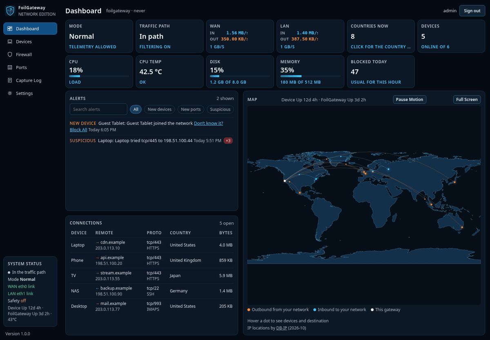
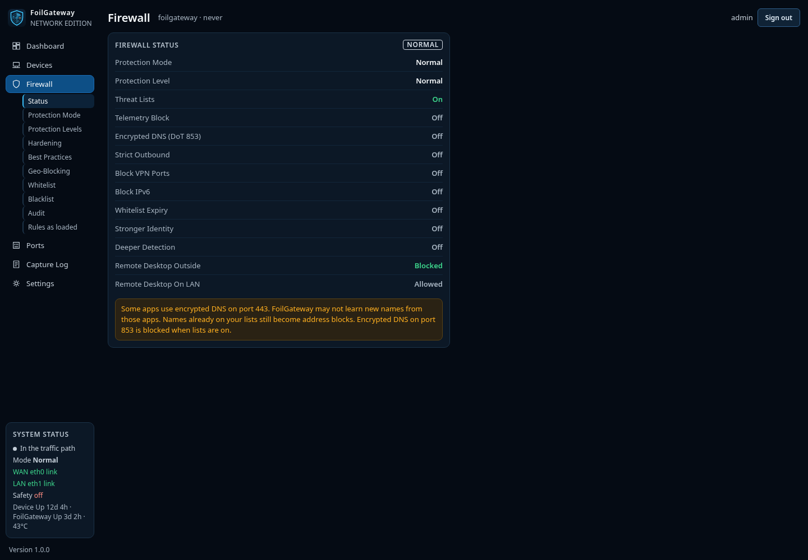
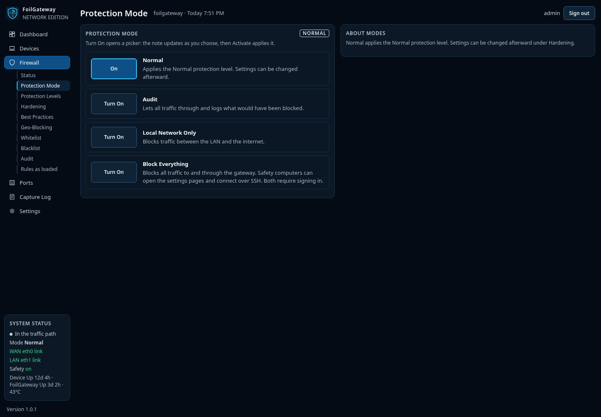
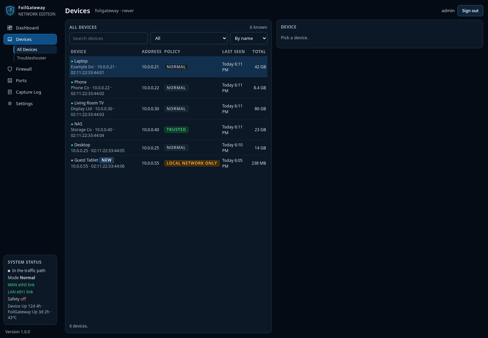
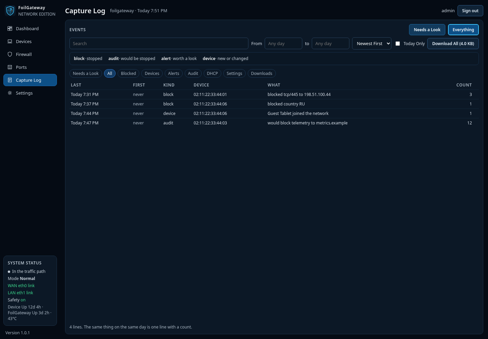
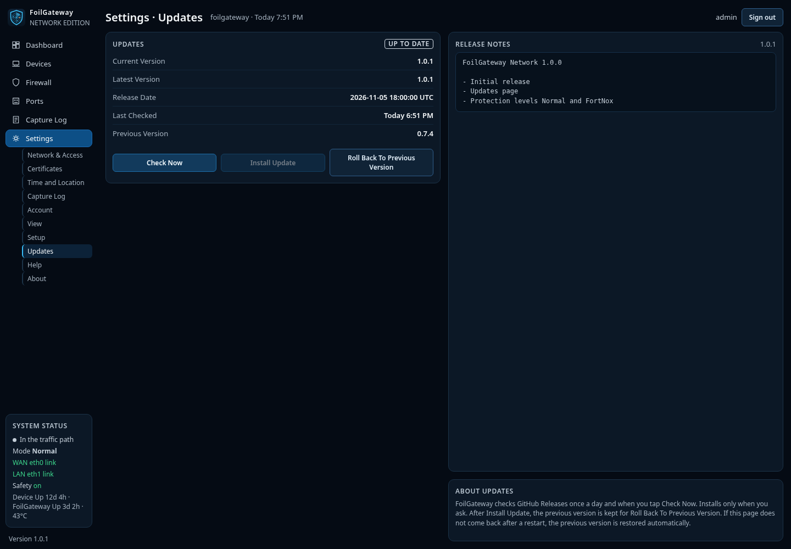
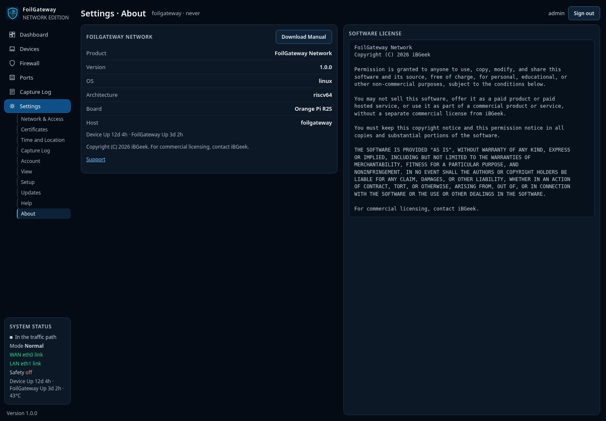
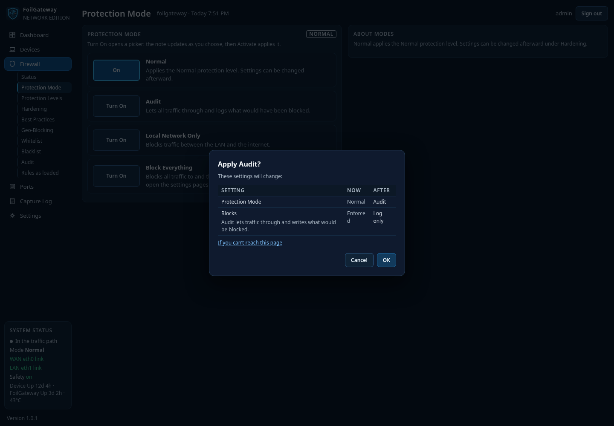

# FoilGateway Network

Firewall gateway for home and office networks.



FoilGateway connects between your router and your network. Your router, DHCP and DNS* keep working as they do now, with no changes to their settings. FoilGateway watches, logs and blocks the traffic that passes through it.

Everything downstream of the LAN port is protected. Anything upstream of the WAN port is not.

[If FoilGateway is useful to you, consider starring the repository on GitHub.](https://github.com/iBgeek/FoilGateway-Network)

## Features

- **Protection Mode** - Normal, Audit, Local Network Only, Block Everything
- **Protection Level** - Normal, FortNox, Custom (Hardening settings under each)
- **Hardening** - Threat Lists, Block All Telemetry, Block Encrypted DNS (port 853), Strict Outbound, Block VPN Ports, Block IPv6, Whitelist Expiry, Stronger Device Identity, Deeper Detection, Remote Desktop controls
- **Geo-Blocking**, **Whitelist**, and **Blacklist**
- **Devices** - per-device policy, Troubleshooter, Connections Now
- **Capture Log** - searchable history of blocks, alerts, audit rows, and settings changes
- **Safety** - always-allowed hosts for settings pages and SSH; both require sign-in
- **Updates** - Settings → Updates checks GitHub Releases and installs only when you ask

## Requirements

- A Linux box with two network ports (WAN and LAN)
- Architecture: x86_64 or riscv64
- systemd

## Install

```sh
curl -fsSL https://github.com/iBgeek/FoilGateway-Network/releases/latest/download/install.sh | sudo sh
```

The installer:

- Detects the architecture and downloads the matching binary, web package, and checksums
- Verifies `SHA256SUMS`
- Installs the service (or upgrades in place if FoilGateway is already there)
- Leaves existing settings untouched on a re-run

Then open `https://<box>:8443` and finish setup in the browser.

Release assets (also attached to each [GitHub Release](https://github.com/iBgeek/FoilGateway-Network/releases)): `foilgw-riscv64`, `foilgw-x86_64`, `foilgw-web.tar.gz`, `install.sh`, `SHA256SUMS`, `FoilGateway-Manual.html`.

## Update

**Settings → Updates**

- **Check Now** - asks GitHub for the latest release. A daily check also runs in the background.
- **Install Update** - downloads the matching binary and web package, checks `SHA256SUMS`, installs, and restarts. Shown only when a newer release is available. Updates never install by themselves.
- **Roll Back To Previous Version** - restores the version kept from the last update.

If the settings page does not come back after Install Update, FoilGateway restores the previous version within the undo timer.

**If the built in update does not complete, running the install command again also upgrades in place and keeps your settings.**


## Manual

[FoilGateway-Manual.html](https://github.com/iBgeek/FoilGateway-Network/releases/latest/download/FoilGateway-Manual.html) (also on each release)

Help inside the product matches the manual. Use Download Manual on Help or About for a local copy.

## Screenshots

Dummy data for illustration.

| Page | |
| --- | --- |
| Firewall → Status |  |
| Protection Mode |  |
| Devices |  |
| Capture Log |  |
| Settings → Updates |  |
| Settings → About |  |
| Protection change preview |  |

## Support

[Contact Support](https://github.com/iBgeek/FoilGateway-Network/discussions/1)

* Block Encrypted DNS stops DNS over TLS on port 853. It is Off by default and in the Normal protection level, and On in FortNox. While it is On, devices set to require DNS over TLS cannot look up names. Change it under Firewall → Hardening.

## Software License

Copyright (C) 2026 iBGeek

Permission is granted to anyone to use, copy, modify, and share this software and its source, free of charge, for personal, educational, or other non-commercial purposes, subject to the conditions in [LICENSE](LICENSE).

You may not sell this software, offer it as a paid product or paid hosted service, or use it as part of a commercial product or service, without a separate commercial license from iBGeek.

THE SOFTWARE IS PROVIDED "AS IS", WITHOUT WARRANTY OF ANY KIND. See [LICENSE](LICENSE) for the full text.
